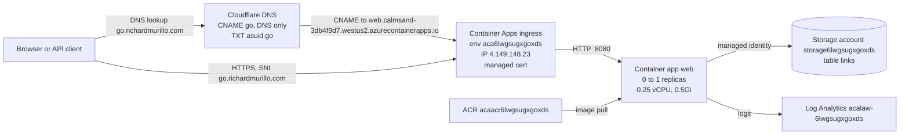

# go.richardmurillo.com URL shortener

Start here. This page tells you what the service is, where every piece lives, and the rules you must follow. Read the whole page before you run any command.

Other docs:

- [runbook.md](runbook.md): step-by-step recipes (create a link, run locally, test, deploy, rotate the API key, fix DNS, re-bind the certificate, view logs, tear down).
- [troubleshooting.md](troubleshooting.md): symptom-indexed decision tree for failures and outages.

## What it is

A small URL shortener. Richard creates short links with an API call. Anyone can follow a short link.

- `POST https://go.richardmurillo.com/api/links` with header `X-Api-Key` and JSON body `{"url":"https://..."}` creates a link.
- `GET https://go.richardmurillo.com/<slug>` redirects (HTTP 302) to the stored URL.
- `GET https://go.richardmurillo.com/` redirects (HTTP 302) to `https://richardmurillo.com`.
- `GET /health` (readiness) reads a known sentinel entity (`_health`) from Azure Table Storage and returns `503 Unhealthy` if storage is unreachable or the value is wrong. `GET /alive` (liveness) checks only that the process runs. Container Apps probes both.

The app is ASP.NET Core on .NET 10. It is orchestrated and deployed with Aspire 13.6. It runs on Azure Container Apps and stores links in Azure Table Storage. DNS is on Cloudflare.

## Safety rules for agents

Follow these rules every time. They are not optional.

1. **Never print a secret.** Secrets are the production API key and the Cloudflare API token. Do not `echo` them, do not run `op read` without capturing the output in a variable, and do not run `az containerapp secret show` without piping it to a hash. To prove a secret exists or matches, print only its length or the first 12 characters of its SHA-256 hash. Example: `printf '%s' "$(op read op://Hermes/GO_RICHARDMURILLO_SHORTENER_API_KEY/credential)" | sha256sum | cut -c1-12`.
2. **Never turn on the Cloudflare proxy (orange cloud) for `go`.** The `go` CNAME must stay "DNS only" (`proxied: false`). Azure issues and renews the TLS certificate by checking that CNAME. If the proxy is on, renewal fails and HTTPS breaks.
3. **Never deploy with an empty `certificateName`.** The value lives in [`src/UrlShortener.AppHost/appsettings.json`](../../src/UrlShortener.AppHost/appsettings.json) under `Parameters:certificateName`. It must be `mc-aca6lwgsugxgox-go-richardmurill-5559` (or the name of whatever managed certificate currently exists). An empty value unbinds HTTPS on the custom domain.
4. **Never read or print `~/.aspire/deployments/*/production.json`.** It caches deploy parameters, including the production API key in plain text.
5. **Do not commit `.env` or any `.env.*` file except `.env.op`.** `.env.op` contains only `op://` references, not secret values.
6. **Ask a human before any command marked "Needs human approval".** The table below lists them.

| Command or action | Effect | Needs human approval |
| --- | --- | --- |
| `aspire destroy` | Deletes all Azure resources, including every stored link. Not reversible. | Yes, always |
| `az group delete -n rg-go-richardmurillo` | Same as above. | Yes, always |
| Deleting or editing Cloudflare DNS records for `go` or `asuid.go` | Breaks the site and certificate renewal. | Yes |
| Changing the Cloudflare `proxied` flag to `true` | Breaks certificate renewal. | Never do this |
| `op item edit GO_RICHARDMURILLO_SHORTENER_API_KEY ...` (key rotation) | Old key stops working after the next deploy. | Yes |
| `op run --env-file=.env.op -- aspire deploy --non-interactive` | Updates production. Idempotent. | Yes, unless the human asked you to deploy |
| `POST /api/links` against production | Creates a permanent link. There is no delete endpoint. | Only for links the human asked for |
| `test/k6/run.sh smoke` or `integration` | Creates or reuses a fixed set of `example.com` test links (idempotent, no new rows after the first run). | No |
| `test/k6/run.sh load` | About 1,600 redirects over 90 seconds against one 0.25 vCPU replica. | Yes |
| `az containerapp show/list`, `az resource list`, `az storage entity query --auth-mode login`, `dig`, `curl` GET requests, `aspire describe` | Read-only. | No |

## Architecture

Request flow: Cloudflare only answers DNS. Traffic goes straight from the client to Azure. The ingress terminates TLS with the managed certificate and forwards to the container on port 8080. HTTP on port 80 gets a 301 redirect to HTTPS.

Scale to zero: the app runs 0 replicas when idle (cooldown 300 seconds). The first request after idle takes about 8 seconds (cold start). Warm redirects take about 80 ms. This is expected.

## Code map

| Path | Purpose |
| --- | --- |
| [`src/UrlShortener.Web/Program.cs`](../../src/UrlShortener.Web/Program.cs) | Endpoints and DI setup. |
| [`src/UrlShortener.Web/LinkService.cs`](../../src/UrlShortener.Web/LinkService.cs) | URL validation, slug generation, collision probing. |
| [`src/UrlShortener.Web/TableLinkStore.cs`](../../src/UrlShortener.Web/TableLinkStore.cs) | Azure Table Storage access. |
| [`src/UrlShortener.Web/ApiKeyEndpointFilter.cs`](../../src/UrlShortener.Web/ApiKeyEndpointFilter.cs) | `X-Api-Key` check (SHA-256 then fixed-time compare). |
| [`src/UrlShortener.Web/LinkStoreHealthCheck.cs`](../../src/UrlShortener.Web/LinkStoreHealthCheck.cs) | Readiness check: round-trips the `_health` sentinel through storage. |
| [`src/UrlShortener.Web/ShortenEndpoint.cs`](../../src/UrlShortener.Web/ShortenEndpoint.cs) | `POST /api/links` handler. |
| [`src/UrlShortener.Web/ShortenerOptions.cs`](../../src/UrlShortener.Web/ShortenerOptions.cs) | Config section `Shortener`: `BaseUrl` (required), `ApiKey` (required, at least 16 characters), `HomeUrl` (optional). |
| [`src/UrlShortener.AppHost/AppHost.cs`](../../src/UrlShortener.AppHost/AppHost.cs) | Aspire model: parameters, storage, Container Apps settings, custom domain. |
| [`src/UrlShortener.AppHost/appsettings.json`](../../src/UrlShortener.AppHost/appsettings.json) | Holds `Parameters:certificateName`. |
| [`src/UrlShortener.ServiceDefaults`](../../src/UrlShortener.ServiceDefaults) | OpenTelemetry, health checks (`/health`, `/alive`), resilience. |
| [`test/UrlShortener.Web.Tests`](../../test/UrlShortener.Web.Tests) | 19 unit and API tests. |
| [`test/k6`](../../test/k6) | k6 smoke, integration, and load suites against the deployed service, with direct Table Storage reads. Run with `test/k6/run.sh`. |
| [`.env.op`](../../.env.op) | Deploy settings and the `op://` reference for the API key. Tracked in git. No secret values. |
| [`aspire.config.json`](../../aspire.config.json) | Points the Aspire CLI at the AppHost project. |
| [`global.json`](../../global.json) | Pins the .NET SDK (10.0.100, roll forward to latest feature band). |

## How links work

- **Validation.** The URL must be absolute, `http` or `https`, at most 2048 characters, and must not point at the shortener host itself. Otherwise the API returns 400.
- **Slug.** The slug is a Murmur3 hash of the normalized URL, encoded in base62 (`A-Z`, `a-z`, `0-9`). Slugs are at most 16 characters. A request for a slug with other characters or longer than 16 returns 404 without touching storage.
- **Idempotent.** Shortening the same URL twice returns the same slug.
- **Collisions.** The service tries Murmur3 seeds 0 through 7 in order. For each seed it tries a conditional insert. If the slug is free, it stores the link. If the slug already holds the same URL, it returns that slug. If the slug holds a different URL, it tries the next seed. If all 8 seeds collide, the request fails with HTTP 500 ("Unable to allocate a unique slug."). This is extremely unlikely.
- **Storage.** Table `links`. PartitionKey is the slug. RowKey is the empty string. Property `Url` holds the target, in normalized form (lowercase scheme and host). The table is created on the first write.
- **Health sentinel.** The readiness check reads entity `_health` with `Url` `https://richardmurillo.com/?source=health-sentinel`, and seeds it if missing. The underscore is outside the base62 alphabet, so `GET /_health` returns 404 and no real link can collide with it. Do not delete or edit this entity; if you do, the next probe re-seeds it (missing) or reports Unhealthy (wrong value).
- **No delete or update API.** To remove a link, a human must delete the entity in the storage account.

## Inventory

All values below were verified against live state.

### Azure

| Item | Value |
| --- | --- |
| Account | `rjmurillo@msn.com` |
| Tenant ID | `9e7cf608-d64e-46a3-846c-576744b06f4c` |
| Subscription | `Paid`, ID `b650d7dc-5e3d-476c-9bbb-299b54b160a0` |
| Resource group | `rg-go-richardmurillo` |
| Region | `westus2` |
| Container Apps environment | `aca6lwgsugxgoxds` (Aspire resource name `aca`, dashboard disabled) |
| Environment default domain | `calmsand-3db4f9d7.westus2.azurecontainerapps.io` |
| Environment static (inbound) IP | `4.149.148.23` |
| Custom domain verification ID | `A8F57878C0EC92FC4107CA2435EC583C8E98D7A04DD58FE799163EDA82997E9D` |
| Container app | `web` |
| Container app FQDN | `web.calmsand-3db4f9d7.westus2.azurecontainerapps.io` |
| Ingress | external, target port `8080`, `allowInsecure: false` (HTTP redirects to HTTPS) |
| Scale | min 0, max 1 replicas, cooldown 300 s |
| Probes | Readiness `GET /health` every 10 s (timeout 5 s, 3 failures). Liveness `GET /alive` every 30 s (timeout 3 s, 3 failures). Port 8080. |
| Resources | 0.25 vCPU, 0.5Gi memory |
| Container app secret | `shortener--apikey` (feeds env var `Shortener__ApiKey`) |
| Image | `acaacr6lwgsugxgoxds.azurecr.io/web:aspire-deploy-<timestamp>` |
| Container registry | `acaacr6lwgsugxgoxds` (SKU Basic) |
| Storage account | `storage6lwgsugxgoxds` (StorageV2, Standard_LRS, shared key access disabled) |
| Table | `links` |
| Human data access | `rjmurillo@msn.com` has `Storage Table Data Reader` on `storage6lwgsugxgoxds` (for k6 backend checks and the portal Storage browser). |
| Managed identities | `web_identity-6lwgsugxgoxds` (app identity, reads and writes tables), `aca_mi-6lwgsugxgoxds` (environment identity, pulls from ACR) |
| Log Analytics workspace | `acalaw-6lwgsugxgoxds` (SKU PerGB2018, workspace ID `df4f79a4-12fe-4562-a6ee-b6bdc7bb87b3`) |
| Managed certificate | `mc-aca6lwgsugxgox-go-richardmurill-5559` (subject `go.richardmurillo.com`, validation CNAME, issuer GeoTrust TLS RSA CA G1 (DigiCert), expires 2027-04-04, auto-renews) |
| Resource provider | `Microsoft.App` must be `Registered` |

### Cloudflare

| Item | Value |
| --- | --- |
| Zone | `richardmurillo.com` |
| Zone ID | `eb3e06806ce27389477ee4730b056822` |
| Account ID | `feda7d698850f3e3b22daa94983216e1` |
| Record `go.richardmurillo.com` | `CNAME` to `web.calmsand-3db4f9d7.westus2.azurecontainerapps.io`, `proxied: false`, TTL 300. Record ID `0904ffed7396c2df0ff76845e3a25393`. |
| Record `asuid.go.richardmurillo.com` | `TXT` with value `A8F57878C0EC92FC4107CA2435EC583C8E98D7A04DD58FE799163EDA82997E9D`, TTL 300. Record ID `74ab46be562e34bf587197ba012ba5d2`. |
| API token | 1Password `op://Hermes/CLOUDFLARE_API_TOKEN/credential`. Account-owned token. |

The Cloudflare token is account-owned. `GET /client/v4/user/tokens/verify` returns an error for it even though the token works. To test it, list the zone DNS records instead. See [runbook.md](runbook.md#recreate-or-fix-the-dns-records).

### Aspire and local tooling

| Item | Value |
| --- | --- |
| Aspire CLI | 13.6.0 at `~/.dotnet/tools/aspire` |
| AppHost project | `src/UrlShortener.AppHost/UrlShortener.AppHost.csproj` |
| AppHost parameters | `apiKey` (secret), `customDomain` (default `go.richardmurillo.com`), `certificateName` |
| AppHost UserSecretsId | `4f0d7a52-3c1e-4b8e-9a64-7d2b1c9e5f31` |
| Local web URL | `http://localhost:5466` |
| Local storage | Azurite emulator in Docker (requires Docker running) |
| Deploy state cache | `~/.aspire/deployments/<hash>/production.json` (contains secrets, never print) |
| Aspire agent skills | [`.agents/skills/`](../../.agents/skills) (`aspire`, `aspire-deployment`, `aspire-monitoring`, `aspire-orchestration`, and others) |
| Aspire MCP server | configured in [`.mcp.json`](../../.mcp.json) |
| 1Password CLI | `op` 2.40, signed in through the desktop app integration |

## Where secrets live

| Secret | Primary location | Other copies |
| --- | --- | --- |
| Production API key | 1Password vault `Hermes`, item `GO_RICHARDMURILLO_SHORTENER_API_KEY`, field `credential`. Reference: `op://Hermes/GO_RICHARDMURILLO_SHORTENER_API_KEY/credential` | Container app secret `shortener--apikey`; Aspire deploy cache `~/.aspire/deployments/*/production.json` |
| Cloudflare API token | 1Password `op://Hermes/CLOUDFLARE_API_TOKEN/credential` | None |
| Local dev API key | .NET user secrets for the AppHost, key `Parameters:apiKey` | None. Different from the production key. |

`.env.op` maps `Parameters__apiKey` to the 1Password reference. `op run --env-file=.env.op -- <command>` resolves the reference and passes the value to the command as an environment variable. `op run` itself writes nothing to disk, but `aspire deploy` caches parameter values, including the key, in `~/.aspire/deployments/<hash>/production.json`. Keep that file mode `600` and never print it.

`op whoami` prints `account is not signed in`. This is normal. The CLI works through the 1Password desktop app. `op read` and `op item get` succeed.

## Cost

About 5 USD per month for the ACR Basic registry, plus a few cents for storage and logs. Compute stays inside the Container Apps free grant because the app scales to zero.

## Branch status

This code lives on branch `feat/aspire-url-shortener` and may not be merged to `main` yet. Run `git -C /home/richard/src/GitHub/rjmurillo/url-bench branch --show-current` to check where you are. Deploy from whichever branch holds the code the human wants in production.
